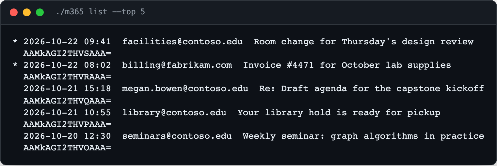

<div align="center">

<h1>m365</h1>

<p><b>A Microsoft 365 mailbox, from the terminal.</b></p>

<p><i>No Outlook window and no SDK: read, search, send and file work mail with one Python script.</i></p>

<h6>


</h6>

<a href="#how-it-works"><b>How it works</b></a> ·
<a href="#install"><b>Install</b></a> ·
<a href="#usage"><b>Usage</b></a>

<br><br>



<sub>The CLI's own list formatter on demo messages (Contoso and Fabrikam are Microsoft's sample names). <code>*</code> marks unread.</sub>

</div>

<br>

## The problem

Checking a work mailbox from a script, or letting an agent read and answer mail, usually means
an Outlook window or a full Microsoft Graph SDK with an app registration. `m365` is a single
executable Python file, standard library only, that signs in with a device code and talks to the
Graph mail API directly. Every command can print JSON with `--json`, so it works for people and
for scripts.

## How it works

<table>
<tr>
<td width="33%" valign="top">

**1 · Sign in**

`./m365 login` starts a device-code flow, copies the code to the clipboard and opens
microsoft.com/devicelogin. Falls back to the v1 endpoint if v2 device codes are refused.

</td>
<td width="33%" valign="top">

**2 · Keep the token**

The token is saved with owner-only permissions under `~/.config/` and refreshed
automatically; a 401 triggers one refresh and retry, a 429 one short wait.

</td>
<td width="33%" valign="top">

**3 · Call Graph**

`list`, `read`, `search`, `send`, `reply`, `move` and `folders` map to Graph mail endpoints,
with friendly folder names like `sent`, `junk` and `trash`.

</td>
</tr>
</table>

## Features

- **No dependencies.** One file, `urllib` and `json`; nothing to install.
- **Device-code login.** No browser automation and no secrets on disk beyond the token.
- **Right-account guard.** Set `M365_ACCOUNT` and a sign-in as anyone else is rejected and its token discarded.
- **KQL search.** `search 'from:alice subject:invoice'` uses Graph's `$search` across the mailbox.
- **Readable bodies.** HTML mail is requested as plain text, with a fallback HTML stripper.
- **Pipe-friendly.** `send` and `reply` read the body from stdin when `--body` is omitted; `--json` on any command.
- **Clear consent errors.** If the tenant blocks the built-in app or the mail scopes, it says so and points to `M365_CLIENT_ID`.

## Install

Python 3 on macOS (login uses `pbcopy` and `open`).

```bash
git clone https://github.com/parthchandak02/m365.git
cd m365
export M365_TENANT=yourcompany.com     # the built-in default is one specific organisation
./m365 login
```

## Usage

```bash
./m365 list --unread --top 10                        # newest unread in the inbox
./m365 list --folder sent                            # any folder by name or id
./m365 search 'from:alice subject:invoice'           # KQL search
./m365 read <id>                                     # one message as plain text
echo "Thanks, see you then." | ./m365 reply <id>     # body from stdin; --all for reply-all
./m365 send --to someone@example.com --subject "Hi" --body "..."
./m365 move <id> --folder archive
```

Limits: primary mailbox only. Graph does not serve the Exchange In-Place Archive. Mail only;
there are no calendar commands.

<details>
<summary><b>All commands and environment</b></summary>

| Command | |
|---|---|
| `login` / `logout` | Device-code sign-in; forget the saved token |
| `whoami` | The signed-in account |
| `list` | Messages in a folder (`--folder`, `--top 1-100`, `--unread`) |
| `read <id>` | One message: from, to, date, subject, body |
| `search <query>` | KQL search (`--top`) |
| `send` | `--to` (repeatable), `--cc`, `--subject`, `--body` or stdin |
| `reply <id>` | `--body` or stdin, `--all` for reply-all |
| `move <id>` | `--folder inbox, sent, archive, junk, deleted` or a folder id |
| `folders` | Every folder with unread and total counts |

| Variable | Purpose |
|---|---|
| `M365_ACCOUNT` | Expected sign-in address; login is rejected if a different account signs in |
| `M365_CLIENT_ID` | Your own public client app, if the tenant blocks the built-in one |
| `M365_TENANT` | Tenant id or domain |
| `M365_CONFIG_DIR` | Where the token is stored |

Scopes requested: `User.Read`, `Mail.ReadWrite`, `Mail.Send`, `offline_access`.

</details>

<br>

<div align="center">
<sub>Built with the Python standard library and Microsoft Graph.</sub>
</div>
